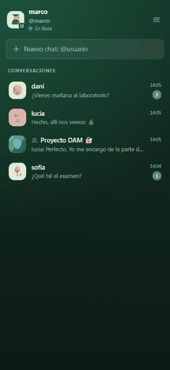
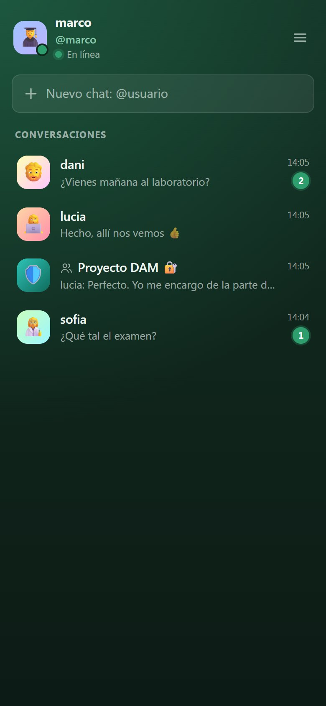
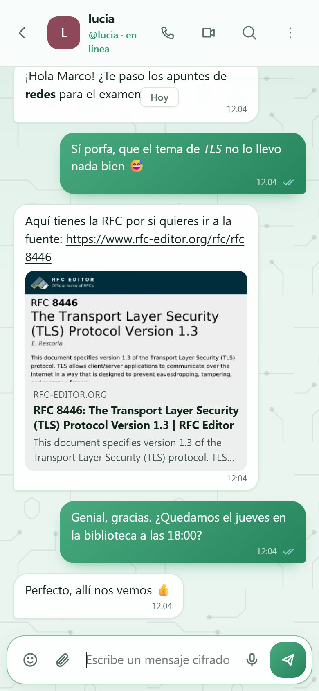
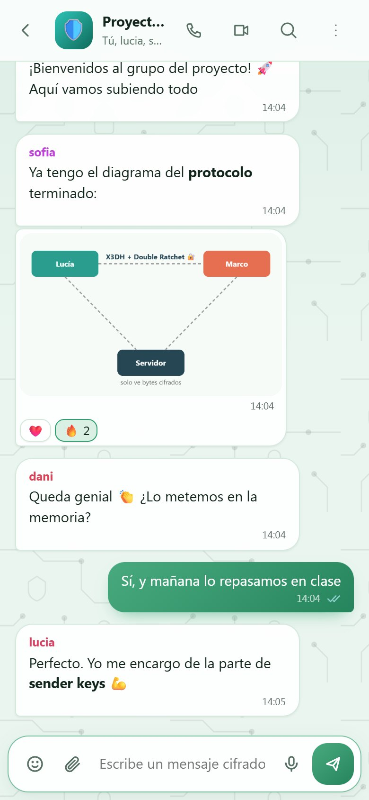
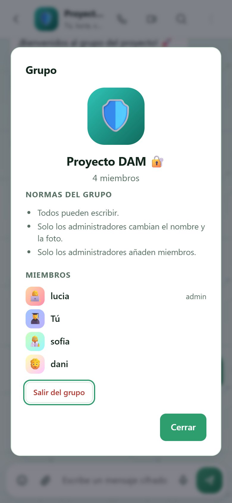
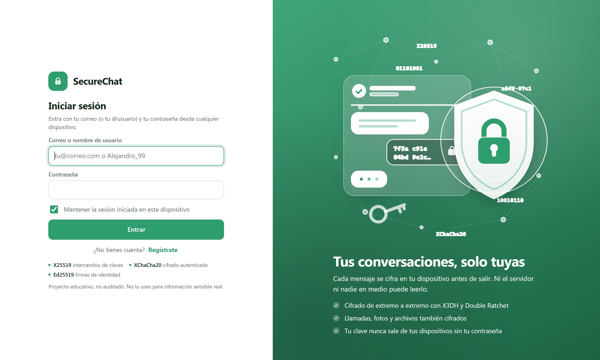
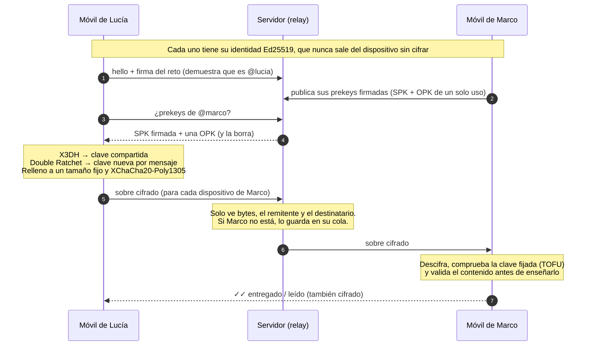

# SecureChat

[](https://github.com/ZaperMaster/securechat/actions/workflows/tests.yml)
[](https://zapermaster.github.io/securechat/)
[](https://github.com/ZaperMaster/securechat/releases/latest)

Mensajería 1 a 1 con cifrado extremo a extremo (E2E) sobre
[libsodium](https://doc.libsodium.org/). Tiene dos clientes que se entienden entre sí:

- **Web / app instalable (PWA)**: el cifrado ocurre en el navegador con libsodium.js.
- **Terminal**: Python con PyNaCl.

El servidor solo reenvía bytes cifrados: nunca ve el texto ni tiene claves para descifrarlo.

Esta versión está pensada para **uso local**: el servidor escucha solo en tu equipo
(o en tu red Wi-Fi con `--lan`) y pide un **código de acceso** que genera al
arrancar. Quien monta el servidor se lo da a sus amigos; sin él no se puede entrar.

## Capturas


| Demo | Chats | Chat con enlace | Grupo | Info del grupo |
|---|---|---|---|---|
|  |  |  |  |  |



## Cómo viaja un mensaje



Lo que el servidor **no** ve: el texto, las fotos, el tipo de mensaje (va dentro del
cifrado), los grupos (cada copia va por separado), los perfiles ni las llamadas (los
datos de audio y vídeo van cifrados de punto a punto con DTLS-SRTP; el relé TURN solo
pasa paquetes).

## Qué hace

- **Identidad Ed25519** por usuario, guardada en disco cifrada con una contraseña
  (Argon2id + XSalsa20-Poly1305).
- **Servidor relay** con autenticación por reto firmado: nadie puede conectarse con
  tu nombre sin tu clave privada.
- **X3DH + Double Ratchet** (el diseño de Signal): cada mensaje usa una clave nueva
  y la sesión se "cura" sola tras un compromiso. Funciona igual esté el otro
  conectado o no, gracias a las *signed prekeys* y las *one-time prekeys*.
- **Protección poscuántica (PQXDH)**: entre clientes web, el inicio de cada sesión mezcla
  además un secreto de **ML-KEM-768** (FIPS 203) con los X25519. Quien grabe hoy el
  tráfico no podrá descifrarlo mañana con un ordenador cuántico. El perfil de cada
  contacto dice si vuestra sesión la tiene.
- **Remitente oculto (*sealed sender*)**: a tus contactos les das, dentro de los mensajes
  cifrados, una "clave de entrega". Con ella te escriben por una conexión anónima y en un
  sobre sellado para ti: el servidor sabe a quién va el mensaje, pero no quién lo manda.
- **Solicitudes de mensaje, bloquear y denunciar**: lo que te escribe un desconocido llega
  como solicitud (no sabe si lo has leído ni te puede llamar) hasta que lo aceptas. Puedes
  no recibir nada de desconocidos, bloquear a alguien (deja de llegarte todo, no ve si
  estás conectado y la clave de entrega cambia) y denunciarle a quien gestiona el servidor,
  adjuntando, si quieres, sus últimos mensajes.
- **Código de recuperación**: al crear la cuenta te da un código de 24 caracteres (120 bits).
  Si olvidas la contraseña, con él entras y pones otra. El servidor guarda una segunda copia
  de tu clave cifrada con el código y solo la entrega a quien demuestra conocerlo.
- **En español o en inglés**: según el idioma del dispositivo, o el que elijas en
  *Opciones → Apariencia*.
- **Varios dispositivos por cuenta** (móvil y ordenador a la vez): cada mensaje se
  cifra para cada dispositivo, y lo que envías desde uno aparece en los demás.
- **Fotos, GIF, vídeos, stickers y emojis**, cifrados igual que el texto. El tipo
  de contenido también va dentro del cifrado: el servidor no sabe si es una foto.
- **Perfil cifrado**: nombre visible y foto que solo ven tus contactos. Al
  recortarla a 256 px se eliminan los metadatos EXIF (por ejemplo la ubicación GPS).
- **@usuario único** con mayúsculas, números, `.`, `-` y `_`. La unicidad no
  distingue mayúsculas, así que `Alice` y `alice` no pueden ser dos personas distintas.
  Al abrir un chat se comprueba que el usuario existe.
- **TOFU** (*trust on first use*): la primera clave vista de un contacto queda
  fijada; si cambia, el cliente muestra un aviso y rechaza la sesión.
- **Números de seguridad** (60 dígitos) en *Perfil → Seguridad avanzada*, para quien
  quiera descartar del todo que el propio servidor suplante a un contacto.
- **Mensajes en diferido**: puedes escribir a alguien desconectado; el servidor
  guarda el mensaje cifrado y se lo entrega a cada dispositivo al conectarse.
- **Grupos con *sender keys*** (como Signal): cada dispositivo tiene una cadena de
  claves por grupo que reparte a los miembros por el canal 1 a 1. Cada mensaje se cifra
  **una sola vez** (y se firma con Ed25519) y el servidor entrega la misma copia a todos:
  una foto de 5 MB a 20 personas sube 5 MB, no 100. La cadena avanza en cada mensaje
  (secreto hacia adelante) y se rota si alguien sale, cada 500 mensajes o cada semana.
  El servidor sigue sin saber que el grupo existe ni cómo se llama.
- **Normas y foto del grupo**: solo administradores escriben, quién cambia nombre y foto,
  quién añade gente. Cada dispositivo comprueba los cambios: si alguien sin permiso lo
  intenta, se ignora.
- **Responder, reaccionar, editar y borrar** (mantener pulsado o clic derecho en un
  mensaje), **notas de voz**, **"escribiendo…"** y **"última vez"** (ocultables).
  Se reacciona con **doble toque** y cualquier emoji. Editar se puede durante 15 minutos
  y borrar para todos durante 1 hora (cada dispositivo rechaza los cambios fuera de plazo).
- **Stickers propios** hechos con tus fotos (cuadrado, redondo o entera, con texto).
- **"Ver una vez"** en fotos, vídeos y notas de voz, eligiéndolo antes de enviar.
- **Mensajes temporales por defecto** para los chats nuevos, si lo activas.
- **Notificaciones con la app cerrada** (Web Push): el aviso no lleva el contenido
  ni el remitente, solo "tienes un mensaje nuevo".
- **Copia de seguridad cifrada** del historial, ajustes de los chats y mensajes
  programados (*Opciones → Copia de seguridad*), que solo tu cuenta puede abrir. Puedes
  hacerla con o sin fotos; la app te recuerda hacerla si pasa más de un mes.
- **Reintentar envíos**: si un mensaje no se puede enviar, se marca en rojo con
  *No se pudo enviar · Reintentar* (también desde el menú del mensaje).
- **Bloqueo de la app** opcional con PIN y, si el dispositivo lo permite, huella, cara
  o Windows Hello (WebAuthn). Se activa en *Opciones → Privacidad*; el PIN se guarda
  solo como hash Argon2id y tras 5 fallos hay que esperar.
- **Notificaciones agrupadas por chat** («3 mensajes nuevos») con botones para
  *Responder* desde la propia notificación y *Marcar como leído*.
- **Vista previa de enlaces** (título, descripción e imagen). La genera el servidor al
  ENVIAR y viaja cifrada dentro del mensaje, así quien lo recibe no visita la web. El
  servidor se protege contra SSRF: solo IP públicas, puertos 80/443, sin re-resolver el
  nombre (DNS rebinding), redirecciones comprobadas y tamaño limitado. Se puede quitar.
- **Pegar con Ctrl+V y arrastrar archivos** al chat abierto o encima de un chat de la
  lista, con una vista previa antes de enviar.
- **Borrar la cuenta** (*Opciones → Borrar mi cuenta*): pide tu contraseña y escribir
  BORRAR, firma la petición con tu clave y el servidor borra claves, copia cifrada, correo
  y mensajes en espera. El @usuario queda libre.
- **Checks como WhatsApp**: 🕓 enviando, ✓ enviado, ✓✓ entregado y ✓✓ azul leído.
  Las confirmaciones viajan cifradas y las de lectura se pueden desactivar.
- **Bandeja de salida**: si te quedas sin conexión (por ejemplo, el móvil corta la
  conexión al pasar la app a segundo plano), los mensajes esperan con 🕓 y salen
  solos al reconectar. La app se reconecta en cuanto vuelves a ella.
- **Sesión recordada e historial**: entras una vez y el dispositivo te recuerda. El
  historial (también fotos y vídeos) se guarda cifrado en el dispositivo.
- **Iniciar sesión desde cualquier dispositivo**: pantallas separadas de "Iniciar
  sesión" y "Crear cuenta". El servidor guarda una copia de tu clave **cifrada con tu
  contraseña** (Argon2id), así que basta con usuario y contraseña en otro equipo.
- **Verificación por correo** opcional al crear cuenta, para frenar bots.
- **Personalización**: 9 temas, color propio, fondos de chat (o tu foto), tamaño de
  letra, forma de las burbujas, estado en el perfil y apodos para tus contactos.
- **Presencia**: ves si tu contacto está en línea o su "última vez".
- **Servicio caído**: si el servidor está apagado, la app lo dice ("quien lo gestiona
  tiene que ponerlo en marcha") y se reconecta sola cuando vuelve.
- Protección contra **repetición, reordenación, manipulación** y claves de orden bajo.

## Uso rápido

```bash
python -m venv .venv
.venv/Scripts/activate            # Windows  (Linux/macOS: source .venv/bin/activate)
pip install -r requirements-dev.txt
```

Arranca el servidor (sirve la web y el relay en el mismo puerto):

```bash
python -m securechat.server
```

Al arrancar muestra la dirección y el **código de acceso** (por ejemplo `K7P2-9QXM`).
Opciones útiles:

- `--lan`: acepta conexiones de otros dispositivos de tu Wi-Fi (muestra tu IP local).
- `--code MI-CODIGO`: usa un código fijo en vez de uno nuevo en cada arranque.
- `--no-code`: sin código (solo para pruebas en tu equipo).
- `--email`: pide verificar un correo al crear cuenta. Necesita un servidor SMTP en
  las variables `SECURECHAT_SMTP_HOST`, `SECURECHAT_SMTP_USER`,
  `SECURECHAT_SMTP_PASSWORD` (y opcionalmente `_PORT` y `_FROM`). Con Gmail, usa una
  *contraseña de aplicación*.
- `--email-pruebas`: igual, pero el código se muestra en la consola del servidor.

Los datos del servidor (usuarios y mensajes en espera, siempre cifrados) se guardan en una
base de datos **SQLite** (`server_users.db`): cada cuenta es una fila, solo se escribe lo que
cambia y siempre dentro de una transacción, así que un corte de luz no la deja a medias. Si
tenías la versión anterior (`server_users.json` y `server_queue/`), se migra sola al arrancar y
los ficheros viejos quedan como copia (`*.migrado`).

### Web

Abre <http://localhost:8765> en dos pestañas o navegadores y crea una cuenta en
cada una (por ejemplo `Alice` y `bob`) con el código de acceso del servidor. Escribe el @usuario del otro en "Nuevo chat":
si no existe te lo dice y no se crea el chat. Pulsa sobre tu nombre para poner
tu nombre visible y tu foto.

- 😊 abre emojis y stickers; 📎 envía fotos, GIF o vídeos (máx. 8 MB). También
  puedes pegar una imagen o arrastrarla al chat.
- La clave privada se genera en el navegador y se guarda en `localStorage`, cifrada
  con tu contraseña (Argon2id). En *Mi perfil → Seguridad avanzada* puedes exportarla
  como `identity.json`, compatible con la versión de terminal.
- El historial se guarda cifrado en el dispositivo (IndexedDB).
- En Chrome/Edge aparece **Instalar app** (o el icono de instalar en la barra de
  direcciones) y se abre en su propia ventana, como una app.

### En el móvil (misma red Wi-Fi)

Los navegadores solo permiten instalar apps y usar algunas APIs en **HTTPS** (salvo
en `localhost`), así que para el móvil genera un certificado propio:

```bash
mkdir certs
openssl req -x509 -newkey ec -pkeyopt ec_paramgen_curve:prime256v1 -nodes -days 365 -subj "/CN=securechat-local" -addext "subjectAltName=DNS:localhost,IP:127.0.0.1,IP:192.168.1.19" -keyout certs/key.pem -out certs/cert.pem
```

(cambia `192.168.1.19` por la IP de tu PC: `ipconfig` en Windows). Luego:

```bash
python -m securechat.server --lan --cert certs/cert.pem --key certs/key.pem
```

Abre `https://192.168.1.19:8765` en el móvil, acepta el aviso del certificado
autofirmado y usa *Añadir a pantalla de inicio*. Puede que Windows pida permitir
Python en el firewall. Un certificado autofirmado es aceptable para pruebas en tu
red; no lo es para un despliegue real.

### Terminal

Dos usuarios en dos terminales (pueden hablar también con usuarios de la web).
Añade `--code` con el código del servidor a `chat`:

```bash
python -m securechat init --name alice
python -m securechat chat --name alice --code K7P2-9QXM
```

```bash
python -m securechat init --name bob
python -m securechat chat --name bob --code K7P2-9QXM
```

Dentro del chat de Alice:

```
> /open bob
> hola Bob
> /fp bob          # muestra el número de seguridad; Bob ejecuta /fp alice
> /verify bob      # solo si ambos números coinciden
```

Tests (los de interoperabilidad web ↔ Python necesitan Node.js; si no está, se saltan):

```bash
pytest -q                          # todo, incluidas las pruebas de la web
node --test tests/web/*.test.mjs   # solo las del cliente web
pip install -r requirements-e2e.txt && python -m playwright install chromium
pytest -q tests/test_browser.py    # la app en un navegador de verdad (registro, solicitudes,
                                   # bloquear, recuperar la cuenta y una llamada de voz)
```

GitHub Actions ejecuta todo en cada push. Además, **Dependabot** propone actualizar las
dependencias cada semana y una **auditoría** (`pip-audit`, `npm audit`) avisa de fallos de
seguridad conocidos en las librerías.

## Apps de Windows y Android

### Windows (`desktop/`, Electron)

Instalador `SecureChat-Setup-1.1.1.exe` y versión portable. Se abre maximizada, al cerrarla
se queda en la bandeja (siguen llegando mensajes y llamadas) y puede iniciarse con Windows.

- **Se actualiza sola**: cada 6 horas mira si hay una versión nueva en las
  [Releases de GitHub](https://github.com/ZaperMaster/securechat/releases), la descarga y
  se instala al cerrarla (o desde *Reiniciar para actualizar* en la bandeja). Antes de
  instalar nada **comprueba una firma Ed25519** del instalador con una clave que solo tiene
  quien publica la app (`privado/actualizaciones`, fuera de git). La firma cubre la versión
  y el SHA-512, así que ni un instalador subido por otro ni uno viejo se aceptan. La versión
  portable solo avisa de que hay una nueva.

- **El código va dentro del programa**: abre la dirección del servidor, pero las peticiones
  de HTML/JS/CSS se sirven desde los ficheros empaquetados; a la red solo van los datos
  (`config.json`, `/keystore` y el WebSocket cifrado). Un servidor comprometido no puede
  colar código que robe claves.
- Ventana con `sandbox`, `contextIsolation` y sin Node; no navega a otras webs (los enlaces
  se abren en el navegador); solo micrófono, cámara y notificaciones, y solo para el servidor.
- *Fusibles* de Electron: no arranca como Node, sin `NODE_OPTIONS` ni `--inspect`, cookies
  cifradas y comprobación de integridad del paquete. En la versión instalada tampoco se
  permite abrir un puerto de depuración remota.

```bash
cd desktop && npm install && npm run build      # -> desktop/dist/ (y firma la actualización)
```

Para publicar una versión: sube a una release `vX.Y.Z` de GitHub el instalador, su
`.blockmap`, su `.sig` y `latest.yml` (todo sale en `desktop/dist/`).

### Android (`movil/`, Capacitor)

**Descarga:** [SecureChat-Android-2.1.1.apk](https://github.com/ZaperMaster/securechat/releases/download/v1.1.4/SecureChat-Android-2.1.1.apk).
Ábrelo en el móvil y permite instalar apps de este origen cuando te lo pida. Se instala encima de
la versión anterior (misma firma), pero los chats de la app vieja no pasan solos: entra con tu
contraseña y usa *Opciones → Copia de seguridad → Traer mis chats de otro dispositivo*.

- **El código va dentro del APK**, como en Windows: del servidor solo llegan datos
  (`config.json`, `/keystore` y el WebSocket). Un servidor comprometido no puede colar
  JavaScript que robe claves. La página lleva una CSP que solo deja conectar con el servidor.
- **Avisos con la app cerrada por Firebase Cloud Messaging** (Android no admite Web Push dentro
  de una app). Como en la web, el aviso solo dice "tienes un mensaje nuevo" o "te están
  llamando": ni Google ni el servidor ven el contenido ni quién lo envía. Al pasar a segundo
  plano la app cierra la conexión para que el servidor sepa que debe avisar.
- Sin copias en la nube ni traspaso por cable de los datos de la app (`allowBackup=false` y
  reglas de extracción): las claves no salen del móvil.
- Permisos: notificaciones, micrófono y cámara (llamadas y notas de voz).

```bash
cd movil && npm install
bash compilar.sh         # copia la web, compila con Gradle y firma -> movil/salida/
```

Necesita JDK 21 y el SDK de Android. La clave de firma y `google-services.json` de Firebase
**no están en git** (`privado/android/`): sin la clave no se pueden publicar actualizaciones.
En el servidor, la cuenta de servicio de Firebase va junto a la base de datos como
`<base>_fcm.json` (por ejemplo `usuarios_fcm.json`); sin ella simplemente no hay avisos en Android.

## Arquitectura

```
securechat/
  crypto.py        almacén de claves, KDF, huellas y números de seguridad
  ratchet.py       X3DH + Double Ratchet por dispositivo (sin E/S, fácil de testear)
  content.py       formato del contenido cifrado (texto, foto, audio, reacciones, grupos…)
  contacts.py      claves fijadas (TOFU) y estado de verificación
  email_verify.py  verificación por correo (SMTP o consola)
  push.py          notificaciones con la app cerrada (Web Push con VAPID)
  server.py        relay WebSocket por dispositivo + servidor de la web estática
  client.py        lógica de red del cliente, independiente de la interfaz
  cli.py           interfaz de terminal
web/
  js/protocol.js   identidad, KDF y huellas (mismos bytes que crypto.py)
  js/ratchet.js    port de ratchet.py (mismos bytes)
  js/senderkeys.js sender keys de los grupos (cadena por dispositivo, firma Ed25519)
  js/client.js     port de client.py
  js/app.js        interfaz (solo usa textContent: nunca interpreta HTML recibido)
  js/vault.js      sesión recordada (WebCrypto) e historial cifrado (IndexedDB)
  js/emoji.js      emojis y stickers
  sw.js, manifest.webmanifest   PWA instalable y notificaciones
  js/i18n.js, js/lang-en.js   traducción al inglés de la interfaz
  vendor/          libsodium.js 0.7.15 y ML-KEM-768 de @noble/post-quantum 0.7.1 (copiados, sin CDN)
tests/
  test_ratchet.py      el protocolo, incluido un fuzz de 200 mensajes desordenados
  test_web_interop.py  ejecuta el JS en Node y conversa con Python mensaje a mensaje
  test_preview.py      vista previa de enlaces y protección contra SSRF
  test_web_client.py   lanza las pruebas del cliente web (tests/web/*.test.mjs) con Node
  test_web_e2e.py      clientes web reales contra el servidor: remitente oculto, bloqueos, PQXDH
  test_browser.py      la app completa en Chromium/Edge con Playwright
  web/                 pruebas del JS de la web: relleno, validación del contenido,
                       identidad, firmas y números de seguridad
```

`ratchet.py` no hace E/S: toda la criptografía de la conversación se prueba sin red.
La versión JS se valida contra la Python en los tests: misma derivación de claves,
mismo número de seguridad, mismo formato de `identity.json` y conversación real.

## Protocolo

Mensajes JSON sobre WebSocket. `IK` es la identidad Ed25519 de la cuenta (convertida
a X25519 para los DH), `|` concatenación con longitud prefijada.

**Autenticación con el servidor**

```
C -> S  hello { user, IK, device }
S -> C  challenge { nonce (32 bytes aleatorios) }
C -> S  auth { Sig_C("securechat-auth-v1" | nonce | user) }
```

El servidor fija `user -> IK` la primera vez y rechaza después cualquier otra clave.
Cada cuenta puede tener hasta 6 dispositivos; todos comparten `IK` (se recupera con
la copia cifrada con tu contraseña) pero cada uno tiene sus propias prekeys.

**Prekeys de cada dispositivo**

```
SPK  = X25519 firmada: Sig_IK("spk" | user | device | SPK | fecha)   (se renueva cada 7 días)
OPK  = 20 X25519 de un solo uso; el servidor entrega una por petición y la borra
KEM  = ML-KEM-768 firmada: Sig_IK("kem" | user | device | KEM | fecha)   (solo la web; cada 7 días)
```

**X3DH** (para escribir a un dispositivo por primera vez, aunque esté desconectado)

```
DH1 = DH(IK_A, SPK_B)   DH2 = DH(EK_A, IK_B)   DH3 = DH(EK_A, SPK_B)   DH4 = DH(EK_A, OPK_B)
AD  = A | dispositivo_A | B | dispositivo_B | IK_A | IK_B
SK  = KDF(BLAKE2b(DH1 | DH2 | DH3 | DH4), "sc-x3dh", AD)

Con KEM (PQXDH):  (CT, SS) = ML-KEM-768.Encaps(KEM_B)      el primer mensaje lleva CT
SK  = KDF(BLAKE2b(DH1 | DH2 | DH3 | DH4 | SS), "sc-pqxdh", AD)
```

Si el otro no publica prekey poscuántica (la terminal), se usa X3DH clásico.

**Double Ratchet** (el algoritmo de Signal, tal cual)

```
(RK, CK)  = KDF(RK, DH(DHs, DHr))      al cambiar el turno de quién escribe
(CK, MK)  = (KDF(CK, "sc-ck"), KDF(CK, "sc-mk"))   en cada mensaje
ct = XChaCha20-Poly1305(MK, nonce, aad = AD | DHs | PN | N)
```

Se guardan hasta 2000 claves de mensajes saltados (llegan desordenados) y se borran
al usarse. Si los dos empiezan a escribirse a la vez, cada dispositivo guarda las
últimas sesiones y "asciende" la que funciona, como hace Signal. El estado de cada
sesión se guarda en el dispositivo cifrado con una clave derivada de la identidad.

**Varios dispositivos**: cada mensaje se cifra una vez por cada dispositivo del
destinatario y otra por cada uno de mis otros dispositivos (envuelto como `sync`). El
servidor entrega a cada dispositivo o lo guarda en su cola si está desconectado.

**Remitente oculto**

```
UAK   = KDF(semilla_IK, "sc-uak", época)[0..16]     cada cuenta publica la suya en el servidor
        (va dentro de los mensajes cifrados a mis contactos; cambia de época al bloquear a alguien)
sobre = crypto_box_seal({ from, mensaje_ratchet }, X25519(IK_destinatario))
C -> S  (conexión anónima) sealed-send { to, device, UAK_destinatario, sobre }
S -> B  deliver { from: null, sobre }
```

B abre el sobre y lo acepta solo si `from` es un contacto con la identidad ya fijada; el
ratchet comprueba que de verdad es él (sin sus claves de sesión no se puede descifrar).

## Modelo de amenazas

**Atacante considerado:** controla la red y/o el servidor relay. Puede leer, borrar,
reordenar, repetir e inyectar mensajes, y registrar usuarios falsos.

| Protegido | Cómo |
|---|---|
| Confidencialidad del contenido | AEAD con claves que solo conocen los dispositivos de los dos |
| Integridad y autenticidad | Poly1305 + X3DH con las identidades de ambos |
| Suplantación de remitente | el remitente lo fija el servidor tras el reto firmado, y X3DH lo liga a su `IK` |
| Repetición / reordenación | claves de un solo uso (ratchet y OPK); se borran al usarse |
| MITM en el primer contacto | **solo si** se comparan los números de seguridad |
| MITM tras el primer contacto | claves fijadas (TOFU): un cambio dispara una alerta |
| Robo posterior de la clave de identidad | secreto hacia adelante (claves efímeras y OPK) |
| Robo del estado de una sesión | "curación": el siguiente DH del ratchet lo deja inservible |
| Robo del fichero de claves | cifrado con Argon2id; depende de la fuerza de la contraseña |

**No protegido** (limitaciones conocidas):

- **Metadatos**: con el remitente oculto, en los mensajes 1 a 1 entre contactos el
  servidor no sabe quién envía. Aun así ve a quién va cada mensaje, cuándo y su tamaño
  aproximado, la IP de cada conexión (y podría relacionar por tiempos la conexión anónima
  con la normal), quién pide las prekeys de quién (al empezar una sesión) y el remitente de
  los mensajes que se mandan a quien aún no te ha dado su clave de entrega. En los grupos
  también va oculto: el cuerpo se cifra una vez y cada miembro recibe una cabecera sellada
  con el autor, su dispositivo y el grupo.
  Usa TLS (`wss://`) delante del relay para ocultarlos al menos a la red.
- **Bloqueos y denuncias**: para que un bloqueado deje de llegarte (ni avisos al móvil), el
  servidor guarda tu lista de bloqueados. Las denuncias las lee quien gestiona el servidor
  (`python -m securechat.server --denuncias`), con los mensajes que hayas decidido adjuntar.
- **Poscuántico**: solo protege el *inicio* de la sesión frente a quien grabe hoy y tenga un
  ordenador cuántico mañana; las firmas (Ed25519) y el ratchet siguen siendo clásicos, y un
  servidor malicioso podría quitar la prekey poscuántica (el perfil lo enseñaría como "no").
- **Primer contacto sin verificar**: si el servidor es malicioso desde el principio
  y nunca comparáis los números de seguridad, puede hacer de intermediario.
  Escribir bien el @usuario no basta: quien controla el servidor decide a quién
  entrega tus mensajes. Por eso la verificación existe, aunque esté escondida en
  *Seguridad avanzada* para no estorbar en el día a día (igual que en Signal o WhatsApp).
- **Existencia de usuarios**: cualquiera puede preguntar si un @usuario existe y
  si está conectado. Se limita a 30 búsquedas por minuto para frenar la enumeración.
- **Tamaño de los mensajes**: los mensajes se rellenan a tamaños fijos (256 B, 1 KB,
  4 KB, 16 KB, 64 KB y luego múltiplos de 64 KB), pero un envío de 3 MB sigue delatando
  que es una foto o un vídeo.
- **Vista previa de enlaces**: el servidor ve la dirección que compartes (no a quién).
  Si no quieres, desactívala en *Opciones → Privacidad*.
- **Bloqueo con PIN**: es una pantalla de privacidad frente a quien coja tu móvil
  desbloqueado, no cifrado extra: un PIN de 4 cifras se puede adivinar con acceso a los
  ficheros del navegador.
- **Búsqueda de GIF**: no hay buscador tipo Giphy/Tenor porque enviaría lo que
  buscas a un tercero. Los GIF se envían desde tu dispositivo.
- **Disponibilidad**: el servidor puede descartar mensajes o desconectar usuarios.
- **Dispositivo comprometido**: con malware en tu equipo no hay cifrado que valga.
  Python además no permite borrar claves de memoria de forma fiable.
- **Sesión recordada**: la semilla de tu identidad queda cifrada con una clave
  WebCrypto no exportable. Nadie puede copiarla a otro equipo, pero quien use tu
  navegador sí podría abrir la app. "Cerrar sesión" la borra del dispositivo.
- **Copia de la clave en el servidor**: está cifrada con tu contraseña (Argon2id) y el
  servidor no puede abrirla. Además, **el servidor solo la entrega a quien demuestra
  saber la contraseña**: el cliente saca de la misma derivación Argon2id una "prueba"
  (con otra etiqueta) y el servidor guarda solo su hash. Así nadie puede llevársela para
  probar contraseñas sin conexión: tiene que hacerlo contra el servidor, que bloquea la
  cuenta 15 minutos tras 10 fallos. Quien controle el propio servidor sí podría intentarlo
  sin conexión, por eso se exigen contraseñas de 10 caracteres o más que no sean de las
  más comunes.
- **Código de recuperación**: quien lo tenga entra en tu cuenta, igual que con la contraseña.
  No se puede adivinar (120 bits) y el servidor solo guarda el hash de la prueba, pero hay que
  guardarlo bien. Se puede cambiar o quitar en *Opciones → Código de recuperación*.
- **Historial local**: va cifrado con una clave derivada de tu identidad. Protege
  frente a quien copie los ficheros del navegador sin tu sesión, no frente a malware.
- **Correo**: el servidor lo ve al crear la cuenta para enviarte el código, pero solo
  guarda una huella (HMAC con un secreto propio) para impedir cuentas repetidas.
- **Confirmaciones de entrega y lectura**: van cifradas, pero su tamaño y momento
  revelan al servidor que hubo actividad. Las de lectura se pueden desactivar.
- **Presencia**: el servidor sabe cuándo te conectas y se lo dice a quien ha hablado contigo.
- **Código de acceso**: unos 40 bits, con un máximo de 10 intentos fallidos por IP y
  minuto. Es un filtro para que no entre cualquiera, no una medida de cifrado.
- **Código servido por el propio servidor (solo la web)**: en el navegador, el servidor
  entrega el JavaScript que cifra. Un servidor malicioso podría servir código modificado que
  filtre tus claves. Es el problema clásico del E2E en navegador. **Las apps de Windows y
  Android no lo tienen**: llevan el código dentro y del servidor solo reciben datos. La de
  terminal tampoco.
- **`localStorage`**: la clave va cifrada, pero cualquier script inyectado en el
  origen podría leerla mientras la sesión está abierta. La CSP estricta y el uso
  exclusivo de `textContent` reducen ese riesgo.
- **Sin one-time prekeys disponibles**: si a alguien se le acaban (por ejemplo, porque
  un atacante las pide todas), el primer mensaje usa solo la SPK y su secreto hacia
  adelante depende de que la SPK se renueve (7 días), como en Signal.
- **Grupos**: el servidor ve a qué dispositivos entrega cada mensaje (aunque no sepa
  que forman un grupo). Con *sender keys*, alguien que entra al grupo no puede leer lo
  anterior y alguien que sale no lee lo siguiente (se rota la cadena), pero entre dos
  rotaciones el secreto hacia adelante es por cadena, no por mensaje como en 1 a 1.
- **Varios dispositivos**: comparten la identidad de la cuenta; un dispositivo robado
  y con la sesión abierta puede leer los mensajes nuevos hasta que lo desvincules desde
  otro (*Mi perfil → Seguridad avanzada → Tus dispositivos*).
- **Notificaciones**: el servicio de avisos del navegador (Google, Mozilla o Apple) sabe
  cuándo te llega algo, aunque no el qué ni de quién. El servidor solo envía avisos a esos
  servicios (no a cualquier dirección: evita usarlo para llegar a la red interna).
- **Abusos**: los correos de verificación están limitados por IP y por dirección (nadie
  puede usar el servidor para llenar de correos la bandeja de otro) y las búsquedas de
  usuarios, por cuenta. La IP real se toma de la cabecera que añade el túnel, no de la que
  puede inventar el cliente.

## Referencias

- [The X3DH Key Agreement Protocol](https://signal.org/docs/specifications/x3dh/) – Signal
- [The Double Ratchet Algorithm](https://signal.org/docs/specifications/doubleratchet/) – Signal
- [The PQXDH Key Agreement Protocol](https://signal.org/docs/specifications/pqxdh/) – Signal
- [Sealed sender](https://signal.org/blog/sealed-sender/) – Signal
- [FIPS 203: ML-KEM](https://csrc.nist.gov/pubs/fips/203/final) – NIST
- [The Noise Protocol Framework](https://noiseprotocol.org/noise.html)
- H. Krawczyk, [SIGMA: the "SIGn-and-MAc" approach to authenticated Diffie-Hellman](https://www.iacr.org/cryptodb/archive/2003/CRYPTO/1495/1495.pdf) (CRYPTO 2003)
- [Documentación de libsodium](https://doc.libsodium.org/)
- [RFC 7748](https://www.rfc-editor.org/rfc/rfc7748) (X25519), [RFC 8032](https://www.rfc-editor.org/rfc/rfc8032) (Ed25519), [RFC 9106](https://www.rfc-editor.org/rfc/rfc9106) (Argon2)
